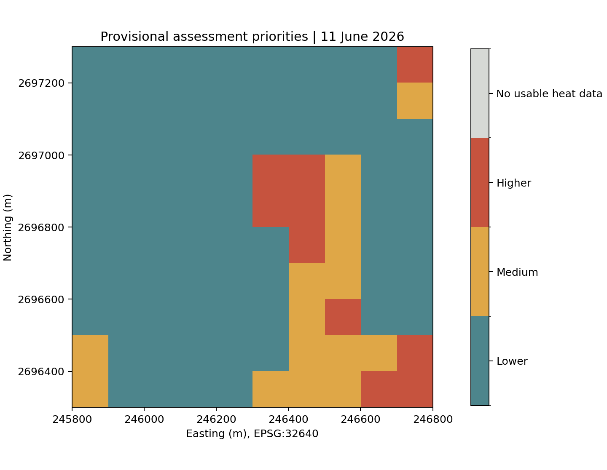
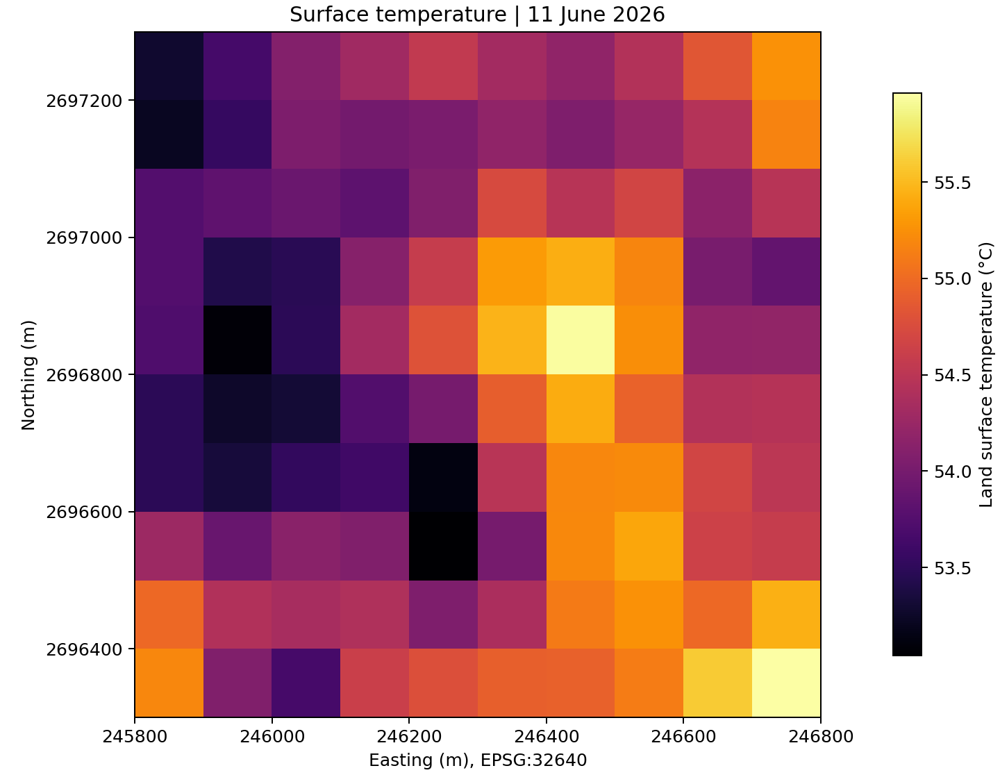

# HeatShield 813

## 1. Title and summary

A reproducible satellite-data proof of concept that identifies provisional cooling-assessment priorities in a 1 km² Mussafah study window, Abu Dhabi.

**Registered team:** UrbanCool AI. **Official competition theme:** Urban Expansion, Land Use Change & Heat Risk. **Country represented:** United Arab Emirates.

[Open the notebook](notebooks/02_main_analysis.ipynb) · [View the PDF slides](docs/slides.pdf) · [Download PowerPoint](docs/slides.pptx) · [Download the interactive map](results/interactive_priority_map.html)

[](https://colab.research.google.com/github/Ruba-Babikir/HeatShield-813/blob/main/notebooks/02_main_analysis.ipynb)

Colab opens the notebook but does not copy the repository's data and code. Clone the repository and install its requirements in Colab before running the notebook, or follow the local instructions below.

## 2. Business use case

The intended user is a municipal urban-planning or environmental team. Its decision is which locations should receive a site assessment for shade, planting, reflective roofs or cooler pavements. The PoC provides observed surface heat, broad spectral signals and a transparent reason for each priority. The working use-case assumption is that planners currently rely on broad heat plans and separate imagery or site inspections; this has not yet been validated through user interviews.

## 3. Problem and scope

Heat and surface conditions vary within cities, while cooling budgets are limited. Satellite observations can compare surface temperature and vegetation signals over many locations on consistent dates. This demonstration tests that decision-support workflow at a small scale.

**Current reproducible AOI:** an independently defined 1 km × 1 km rectangle in Mussafah. Bounds in EPSG:32640 are E 245800–246800 m and N 2696300–2697300 m. There are 100 cells at 100 m spacing. The window was selected from the team's prepared satellite export and contains usable heat observations for all 100 cells. It is a convenience demonstration sample, not a representative sample of the city.

**The intended future pilot remains M11–M12, but the results here are not whole-sector results.** The earlier notebook used an Abu Dhabi SDI community boundary whose [published licence information](https://arcgis.sdi.abudhabi.ae/agspublish/rest/services/OpenData/ADSDI_OpenData/MapServer/2/iteminfo) says “For use by Abu Dhabi government entities only.” The team does not have permission to publish those polygons. This submission excludes them and all sector-membership fields, and uses a new repository without the earlier notebook history. Exact-sector expansion requires suitable permission or an independently permitted boundary.

## 4. Data used

| Dataset | Provider and processing level | Observation | Licence / attribution |
|---|---|---|---|
| Landsat 8 Collection 2 surface temperature | USGS/NASA, Level-2, calibrated and averaged to the 100 m grid | 11 June 2026, 06:51:50 UTC | [US public domain](https://www.usgs.gov/faqs/are-there-any-restrictions-use-or-redistribution-landsat-data), acknowledge USGS |
| Sentinel-2B surface reflectance | Copernicus/ESA, Level-2A, six calibrated band means on the same grid | 11 June 2026, 06:46:19 UTC | [Copernicus Sentinel free, full and open data terms](https://sentinels.copernicus.eu/documents/247904/690755/Sentinel_Data_Legal_Notice). Contains modified Copernicus Sentinel data (2026). |

Exact scenes:

- Landsat: `LC08_L2SP_161043_20260611_02_T1`
- Sentinel-2: `S2B_MSIL2A_20260611T064619_R020_T40QBM_20260611T104324`

Catalogue and upstream hosting: Microsoft Planetary Computer. The input `data/sample_input/satellite_cells.csv` contains **prepared cell values**, not raw scene files. `data/sample_input/provenance.json` records scene identifiers, acquisition timestamps, calibration, quality rules, grid bounds and SHA-256 hashes.

**Hyperspectral data is not used.** Satellite 813 is not a confirmed input. EnMAP/Tanager catalogue exploration in the earlier work did not contribute to these results. ESA WorldCover was a historical comparison in the earlier workflow and is not an input to this sample.

## 5. Technical approach

1. Load the supplied calibrated temperature and six-band reflectance sample. Check identifiers, dates, quality flags and the 10 × 10 grid.
2. Recalculate NDVI, NDBI, MNDWI and BSI from cell-mean reflectance. Reject undefined index denominators. This is different from averaging native-pixel indices.
3. Calculate relative temperature against the median of usable cells on the observation date.
4. Rank observed heat with `100 × (average rank − 0.5) / N`. Use scores ≥90 for higher priority, 75–<90 for medium and <75 for lower. Check hotspot counts at the 85th, 90th and 95th percentiles. These thresholds are exploratory.
5. Evaluate a mean baseline, scaled linear regression and a random forest using four easting strips. Training-cell centres must be more than 200 m from test-cell centres. Use training-only temperature medians. Random forest: 200 trees, maximum depth 8, minimum leaf size 5, seed 42. No model weights are committed.
6. Export maps, per-cell evidence, fold-level metrics and the self-contained interactive HTML map. Candidate actions remain subject to field checks.

Upstream preparation, already applied to the sample: Landsat temperature = `DN × 0.00341802 + 149.0 − 273.15`. Sentinel reflectance uses the selected product's scale `0.0001` and offset `−0.1`. The original workflow masked Landsat QA bits 0–5, saturation and temperature uncertainty above 2 K, and retained Sentinel-2 SCL classes 4/5/6 before averaging. **Do not recalibrate the supplied CSV.** Raw-scene retrieval and preprocessing are outside the offline example.

## 6. Installation

Use **Python 3.12**. Direct dependencies are pinned in `requirements.txt`.

```bash
git clone https://github.com/Ruba-Babikir/HeatShield-813.git
cd HeatShield-813
python -m venv .venv
source .venv/bin/activate
python -m pip install -r requirements.txt
```

On Windows PowerShell, activate with `.venv\Scripts\Activate.ps1` instead of the `source` command.

No API keys, tokens or environment variables are required for the supplied offline sample. Internet access is needed only to clone the repository and install packages. Full satellite acquisition is not required to reproduce this example.

## 7. How to run

```bash
jupyter lab notebooks/02_main_analysis.ipynb
```

Choose **Restart Kernel and Run All Cells**, then save the notebook so outputs stay visible. No input edits are needed. Start Jupyter from the repository root. Expected analysis runtime is under one minute on a typical CPU laptop, excluding installation; the available test environment completed all code cells in approximately four seconds. No GPU is required.

For an automated fresh-kernel run:

```bash
jupyter nbconvert --to notebook --execute notebooks/02_main_analysis.ipynb --output-dir=executed-notebooks --ExecutePreprocessor.timeout=600
python scripts/check_submission.py
```

For plain-Python execution of exactly the same code cells:

```bash
python scripts/run_notebook.py
```

The latter runner is a fresh Python process, not a Jupyter kernel. It preserves the outputs it actually produces. The GitHub `Reproduce notebook` workflow performs the separate Jupyter-kernel check and uploads its executed notebook and results. The same analysis passed a clean installation and fresh-kernel run in the earlier repository. The new repository workflow is pending verification; see `docs/reproducibility_check.json` for the distinction.

The notebook reads `data/sample_input/satellite_cells.csv` and writes to `results/`. The root-level `UrbanCool_AI_Space_Hackathon.ipynb` is an identical convenience copy of the main notebook. Run only one copy.

## 8. Example input and output

- [Sample satellite cells](data/sample_input/satellite_cells.csv)
- [Input provenance and processing settings](data/sample_input/provenance.json)
- [Priority table](results/priority_table.csv)
- [Spatial validation summary](results/validation_summary.csv)
- [Interactive map HTML](results/interactive_priority_map.html): download and open locally; GitHub does not execute HTML files in its file viewer.





## 9. Results and limitations

The independent window contains **100 usable cells on one date**. Observed surface temperatures range from **53.04 to 55.96 °C**, with a mean of **54.36 °C**. The percentile rule assigns **10 higher**, **15 medium** and **75 lower** assessment priorities. These counts follow the chosen ranking thresholds, not independently validated risk categories.

| Model | Mean fold MAE (°C) | Mean fold RMSE (°C) |
|---|---:|---:|
| Mean baseline | 0.817 | 0.934 |
| Linear regression | 0.966 | 1.183 |
| Random forest | 0.746 | 0.878 |

Four buffered spatial folds test each eligible cell once. These are unweighted averages across folds of different sizes. The random forest improves mean fold MAE by approximately **0.071 °C** against the baseline in this window. Linear regression performs worse. Mean fold R² is negative for all models; the results do not demonstrate strong predictive generalisation. See the full per-fold errors and split membership in `results/`.

Limitations:

- One date cannot establish hotspot persistence or support held-out-date validation.
- A selected 1 km² window does not represent the city or the complete M11–M12 sectors. Coverage and rankings are conditional on this sample.
- Land surface temperature differs from air temperature and human heat exposure.
- The input begins after calibration, masking and grid alignment. The offline example does not independently reproduce or validate those upstream steps.
- Index associations do not establish causality, detailed materials, cooling effects or energy savings.
- Site-use, vulnerability, water availability, engineering feasibility and cost are not modelled.
- Independent ground observations and an authorised boundary are still needed for a full operational pilot.

Verification: all nine code cells ran in order locally. Before migration, a separate GitHub Actions run successfully installed the pinned dependencies on a clean Ubuntu runner, executed all cells in a fresh Jupyter kernel, passed the repository checks and uploaded the executed notebook and results. This is historical evidence for the unchanged analysis, not evidence that the new repository has passed. Check the new repository workflow after upload.

## 10. Team, licence and attribution

**Team: UrbanCool AI, United Arab Emirates.**

All five members developed the project collaboratively.

| Member | Role |
|---|---|
| Nyar Adil Babiker Abdelrahman | Team lead and co-developer |
| Shahd Ehab Abdulmalek Eshaq | Co-developer |
| Nour Alhoda Abdulrahman Alahmed | Co-developer |
| Yosra Ghneem | Co-developer |
| Ruba Babikir Ali Mohamed | Co-developer |

**Code licence:** not yet selected by the team. No open-source reuse permission should be inferred. A `LICENSE` file can be added once the team chooses its licence. Dataset terms remain those of their providers.

Data credit: USGS/NASA Landsat programme; contains modified Copernicus Sentinel data (2026). Microsoft Planetary Computer hosted the upstream satellite products. This implementation uses NumPy, pandas, Matplotlib and scikit-learn. The original team's prepared export supplied the satellite cell values. The independent-window notebook recalculates all reported example results.

The restricted Abu Dhabi SDI community polygons are excluded from these files. No permission to publish them has been obtained. This repository starts from a fresh initial README commit and excludes the earlier repository history. The earlier repository is private.

Presentation PDFs must still be attached to the submission form. The supplied portal screenshot shows team approval and five listed members. Final eligibility, deadline, project-page completeness, PDF attachment and acknowledgement of judging remain platform checks that a repository workflow cannot verify.
